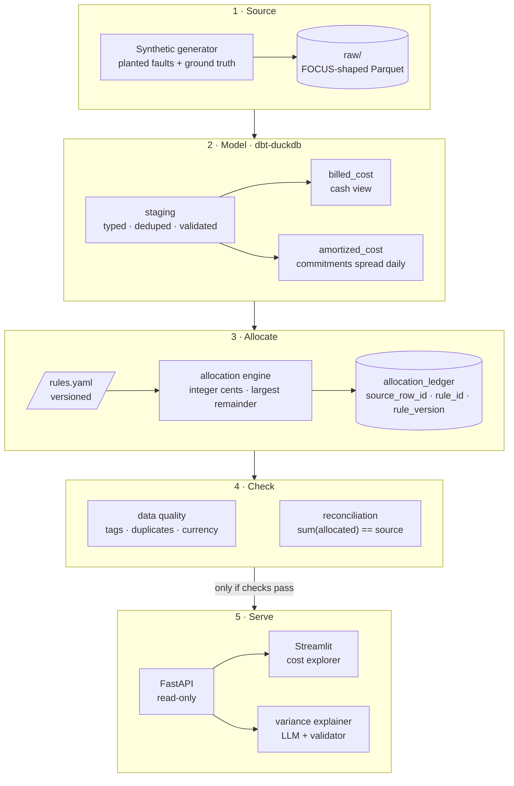
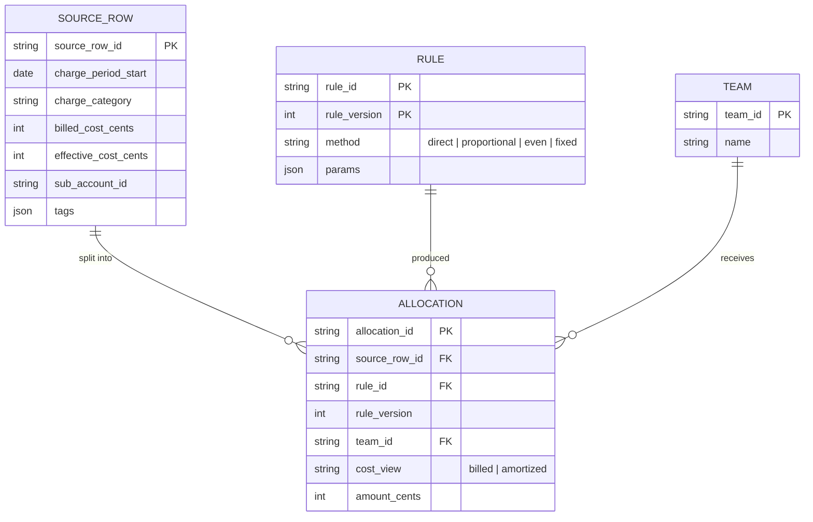
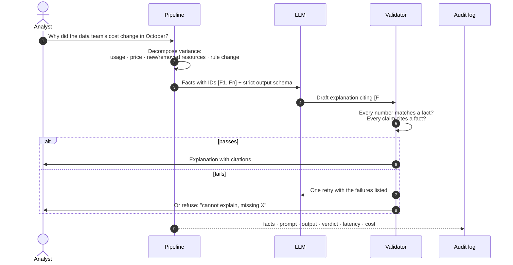

<div align="center">

# CostTrail

**Cloud cost allocation you can trace, line by line, back to the bill.**

[](https://github.com/myekini/costtrail/actions/workflows/ci.yml)


[](LICENSE)

</div>

> [!NOTE]
> **Status: in development.** This README is the design. Sections marked *(planned)* do not exist yet. Results will be published here only when they are measured, on synthetic data.

---

## The question

**Can engineering and finance trace an allocated cost back to its source, and see why it changed?**

Most showback reports fail one of two tests:

1. **They don't add up.** Allocated team costs don't sum to the bill, because shared costs, commitments and credits were split with rounding, double counting or nothing at all.
2. **They can't be explained.** A team's cost went up 18% and nobody can say whether that was usage, price, a new resource, or a change to the allocation rule itself.

CostTrail is a small, inspectable pipeline that passes both tests on purpose. Every allocated cent points back to a source billing row and the rule that moved it.

## What v1 does

| Capability | Detail |
|---|---|
| **Two cost views** | *Billed* cost (what the invoice says, cash basis) and *amortized* cost (commitments and upfront fees spread over the period they cover). Defined separately, never mixed |
| **Total-preserving allocation** | Direct allocation by tags and account, then shared-cost rules (proportional to usage, even split, fixed percentages). Allocations always sum to the source **to the cent** |
| **Lineage** | Every allocated row carries `source_row_id`, `rule_id` and `rule_version` |
| **Data-quality checks** | Tag coverage, untagged and mis-tagged spend, duplicate line items, currency and period consistency |
| **Reconciliation** | Allocated totals vs source totals, for the same period, currency and cost definition only |
| **Cost explorer** | Read-only UI: team → service → resource → source rows |
| **Variance explainer** | The pipeline computes *why* a cost changed. An LLM writes it in plain English. Code checks every number before anyone sees it |

## Architecture



Everything runs locally on DuckDB and Parquet. No cloud account, no warehouse bill, and the demo still works when someone clicks it months later.

## How allocation stays exact

Money is held as **integer cents**. Shares are computed as fractions, floored, and the leftover cents go to the rows with the largest remainders. This makes the invariant hold by construction, not by luck.

```python
def allocate(total_cents: int, weights: dict[str, int]) -> dict[str, int]:
    """Split total_cents by weights so the parts sum exactly to the total."""
    w = sum(weights.values())
    raw = {k: total_cents * v / w for k, v in weights.items()}
    out = {k: int(r) for k, r in raw.items()}                    # floor
    leftover = total_cents - sum(out.values())
    for k in sorted(raw, key=lambda k: raw[k] - out[k], reverse=True)[:leftover]:
        out[k] += 1                                               # largest remainder
    return out

assert sum(allocate(4_820_000, {"platform": 46, "data": 28, "payments": 18, "shared": 8}).values()) == 4_820_000
```

The same invariant is enforced as a test at every grain: per billing period, per currency, per cost definition.

## Data model

CostTrail reads a subset of the [FinOps FOCUS](https://focus.finops.org) columns, so the logic maps to real billing exports from any provider that emits FOCUS.

| Column | Used for |
|---|---|
| `BilledCost` | Billed view |
| `EffectiveCost` | Amortized view (commitments and upfront fees spread) |
| `ChargeCategory` | Usage, Purchase, Tax, Credit, Adjustment handled differently |
| `ChargeFrequency` | One-time vs recurring vs usage-based |
| `ChargePeriodStart` / `ChargePeriodEnd` | Period grain for every check |
| `CommitmentDiscountId` | Linking Savings Plans and reservations to the usage they cover |
| `SubAccountId`, `Tags` | Direct allocation keys |
| `ServiceName`, `ResourceId` | Drill-down and variance decomposition |
| `BillingCurrency` | Reconciliation only within one currency |



## The variance explainer

The LLM never calculates anything. The pipeline decomposes the change into facts, the model only explains them, and a validator checks the explanation against those facts before it is shown.



**Rules the explainer follows**
- Uses only supplied facts. No outside knowledge about pricing or services.
- Cites a fact ID for every figure.
- If a required fact is missing, it says which one and stops.
- Provider-agnostic: a cheap default model, swappable by config.

## Planted faults and how each one is caught

The generator injects known problems and writes a ground-truth file, so every check is scored against the truth.

| Planted fault | Real-world cause | Caught by |
|---|---|---|
| Untagged spend | Resources launched without owner tags | Tag coverage check |
| Mis-tagged resource | Wrong team tag after a reorg | Tag validity against the team registry |
| Duplicate line items | Export re-delivered for the same day | Dedup on natural key in staging |
| Upfront commitment fee | Reservation or Savings Plan bought upfront | Lands in billed view, spread in amortized view |
| Marketplace private offer | Lump-sum purchase for a multi-month term | Amortization rule; double-counting test |
| Late credit | Credit posted in the following period | Period-aware reconciliation |
| Mixed currency row | Row billed in a different currency | Currency consistency check |

## Evaluation *(planned)*

| Area | Metric | Gate |
|---|---|---|
| Allocation | `sum(allocated) − source` per period, currency, view | Exactly 0 cents |
| Data quality | Recall on each planted fault type | Every planted fault found |
| Explainer | Numerical fidelity: numbers in output that match a fact | 100%, or the output is refused |
| Explainer | Unsupported claims per explanation | 0 |
| Explainer | Correct refusals on missing-fact cases | Measured and reported |
| Explainer | Latency p95 and cost per explanation | Measured and reported |

The evaluation set lives in `evals/` and runs in CI. Scores are published here with the commit they came from.

## Design decisions

| Decision | Why | Trade-off |
|---|---|---|
| DuckDB + Parquet, not a cloud warehouse | Free, reproducible, one-command demo | Not a scale test. The logic is the point |
| Integer cents everywhere | Rounding errors are the most common reason showback doesn't tie out | Slightly more code at the edges |
| Billed and amortized as separate views | They answer different questions (cash vs consumption) | Two numbers to explain instead of one |
| Rules as versioned YAML | A rule change is itself a cause of variance and must be traceable | Rule edits need a version bump |
| LLM explains, never computes | Arithmetic belongs in code, where it can be tested | Explanations are only as good as the decomposition |

## Repository layout

```
costtrail/
├── src/
│   ├── generate/       synthetic FOCUS-shaped data + planted faults + ground truth
│   ├── models/         dbt-duckdb staging, billed and amortized views
│   ├── allocate/       allocation engine and rule loader
│   ├── checks/         data quality and reconciliation
│   └── explain/        variance decomposition, LLM client, validator
├── app/                FastAPI service and Streamlit explorer
├── evals/              evaluation sets and scored results
├── tests/              unit tests, including the total-preservation invariant
├── docs/               design notes and decisions
└── .github/workflows/  CI: lint and tests on every push
```

## Roadmap

### Later releases

v1 is the only scope that counts until it ships. After it:

| Release | Adds |
|---|---|
| **v2 Ask CostTrail** | A semantic layer of cost metrics exposed as tools (`get_cost`, `compare_periods`, `allocation_trace`, `tag_coverage`, `top_movers`, `explain_variance`). A FinOps analyst agent that answers questions like "why did the data team's cost rise in September?" through those tools only, and cites the source rows. The same tools served as an **MCP server**, so any MCP-capable assistant can query the cost model. Scored on 40 to 60 questions with known answers, including ones it should refuse |
| **v3 Watch & fix** | A daily anomaly watch (deterministic statistics) with agent-written investigation notes, and a tag-fix proposer: it suggests an owner for untagged spend, a human approves, and the change is written only to CostTrail's own allocation mapping, never to the cloud account |

The agent never writes SQL against raw tables, stays read-only until v3, has every figure checked against its tool results, and treats tags and resource names as untrusted text.

### v1

- [x] Repository, CI, design
- [ ] Synthetic generator with planted faults and ground truth
- [ ] Staging, billed and amortized views
- [ ] Allocation engine with the total-preservation invariant under test
- [ ] Data-quality and reconciliation checks
- [ ] Read-only cost explorer, deployed
- [ ] Variance explainer and its evaluation set
- [ ] First release: one-command run, published scores, 3-minute walkthrough

## Quick start *(planned)*

```bash
git clone https://github.com/myekini/costtrail && cd costtrail
docker compose up        # generates data, builds models, serves the explorer
```

## Known limitations

- **Synthetic data.** Results show performance against the generator's assumptions, not production impact.
- **FOCUS is a data specification, not an amortization method.** The amortization rules used are documented in `docs/` and are one reasonable choice, not the only one.
- **One provider shape in v1.** Multi-cloud, every private-pricing case and commitment optimization are out of scope.
- **Not a replacement for native tooling.** Cloud providers have their own allocation features. CostTrail shows transparent rules and a workflow you can audit.

---

<sub>Built by <a href="https://github.com/myekini">Muhammad Yekini</a>, data engineer and Cloud FinOps analyst. Based on problems solved in production cost reporting. No client data, structures or figures are used.</sub>
